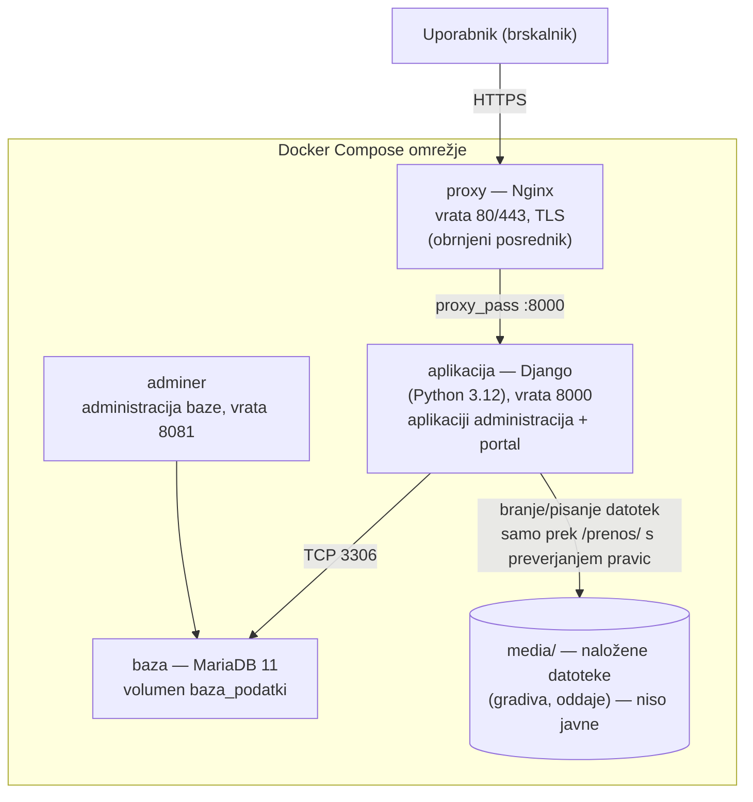

# Arhitektura sistema

Dokument opisuje arhitekturo celotne programske rešitve Šolski IS. Namenjen je
tudi bralcu, ki projekta ne pozna.

## 1. Pregled (diagram arhitekture)



- **Uporabnik** dostopa prek brskalnika samo do posrednika (HTTPS).
- **proxy (Nginx)** prekine TLS, preusmeri `80 → 443` in posreduje zahteve
  aplikaciji. Naložene datoteke namenoma **ne** streže (mapa `media/` ni
  izpostavljena).
- **aplikacija (Django)** vsebuje dve Django aplikaciji:
  - `administracija` — CRUD za predmete, učitelje, učence in njihove relacije
    (pogled administratorja),
  - `portal` — prijava/registracija, avtorizacija po vlogah ter pogleda učitelja
    in učenca (gradiva, oddaje).
- **baza (MariaDB)** teče v ločenem vsebniku z obstojnim (persistentnim)
  volumnom; dostopna je le znotraj Docker omrežja.
- **adminer** je pripomoček za pregled baze med razvojem.

## 2. Programska zgradba (Django)

```
aplikacija/
├── solski_sistem/      nastavitve, glavni URL-ji, WSGI
├── administracija/     modeli (Predmet, Ucitelj, Ucenec + presečni tabeli),
│                       obrazci, CRUD poglede, predloge, seed_podatki
├── portal/             modeli (Profil, Gradivo, Oddaja), avtorizacija
│                       (dovoljenja.py), poglede učitelja/učenca, prijava,
│                       zaščiten prenos datotek, seed_uporabniki
├── templates/          skupna osnovna predloga (base.html)
└── static/             CSS
```

Plasti: **modeli** (podatki), **obrazci** (validacija vnosa), **poglede**
(poslovna logika + preverjanje pravic), **predloge** (prikaz). Preverjanje
pravic je centralizirano v `portal/dovoljenja.py`.

## 3. Podatkovni model

8 tabel; podroben ER diagram in razlaga: [`er-diagram.md`](er-diagram.md).
Ključne entitete: `Predmet`, `Ucitelj`, `Ucenec` (+ presečni tabeli M:N),
`Profil` (vloga + povezava z uporabnikom), `Gradivo`, `Oddaja`.

## 4. Varnostne odločitve

- gesla shranjena zgoščeno (PBKDF2-SHA256);
- avtorizacija po vlogah (administrator / učitelj / učenec), nepooblaščen dostop
  vrne 403;
- naložene datoteke niso javno dostopne (dostop le prek `/prenos/...` s
  preverjanjem pravic);
- HTTPS prek posrednika (samopodpisano potrdilo v razvoju, Let's Encrypt na
  javni domeni);
- redne varnostne kopije baze ([`scripts/varnostna-kopija.sh`](../scripts/varnostna-kopija.sh)).

Podrobnosti namestitve in konfiguracije strežnika: [`streznik.md`](streznik.md).

## 5. Poganjanje in postavitev

Celotno okolje se zažene z enim ukazom `docker compose up -d --build`; podrobni
koraki (razvoj in javna domena) so v [`streznik.md`](streznik.md) in
[`../README.md`](../README.md).
