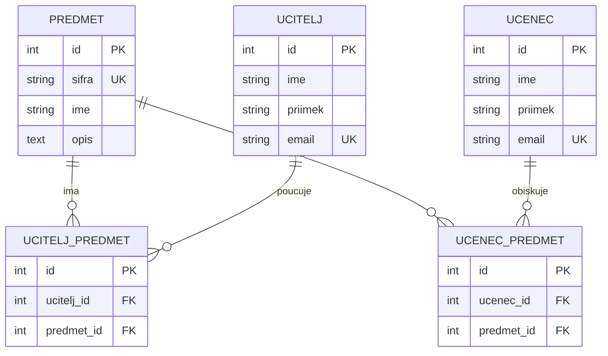
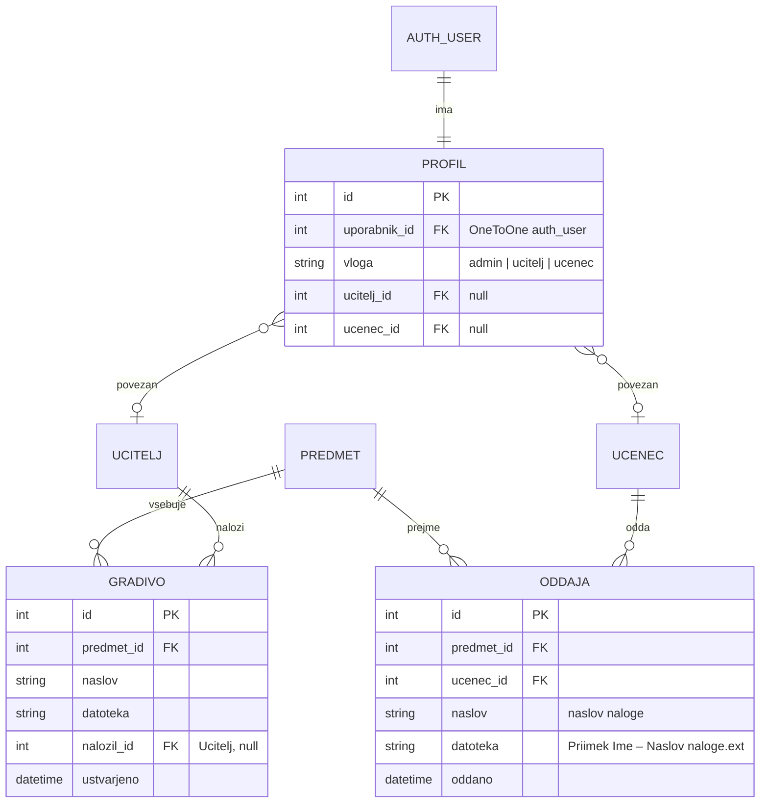

# ER diagram podatkovne baze

## Trenutna shema (implementirana do 3. tedna)

`UCITELJ_PREDMET` in `UCENEC_PREDMET` sta eksplicitni presečni (M:N) tabeli z
unikatno omejitvijo na paru tujih ključev (`(ucitelj_id, predmet_id)` in
`(ucenec_id, predmet_id)`), kar preprečuje podvojene povezave. Skupaj je to
**5 tabel**, kar presega zahtevanih najmanj 4.

## Razširitev v 4. tednu (prijava, gradiva, oddaje) – implementirano

Ključne odločitve:

- **`PROFIL`** povezuje Djangov vgrajeni model uporabnikov
  (`django.contrib.auth.User`, ki hrani zgoščeno geslo) z vlogo in – po potrebi –
  z zapisom `UCITELJ` ali `UCENEC`. Dve vrsti prijavljenih uporabnikov po
  zahtevi sta učitelj in učenec; administrator je tretja vloga
  (`is_staff`/`is_superuser`).
- **`ODDAJA`** je vezana neposredno na `PREDMET` (in ne na ločeno tabelo nalog),
  saj navodila od učitelja ne zahtevajo vnaprejšnjega ustvarjanja nalog –
  učenec odda nalogo z naslovom. Unikatna omejitev `(ucenec, predmet, naslov)`
  poskrbi, da ima ista naloga učenca eno oddajo; ponovna oddaja jo povozi (po
  potrditvi).
- Skupno je zdaj **8 tabel** (5 iz 3. tedna + `PROFIL`, `GRADIVO`, `ODDAJA`).
