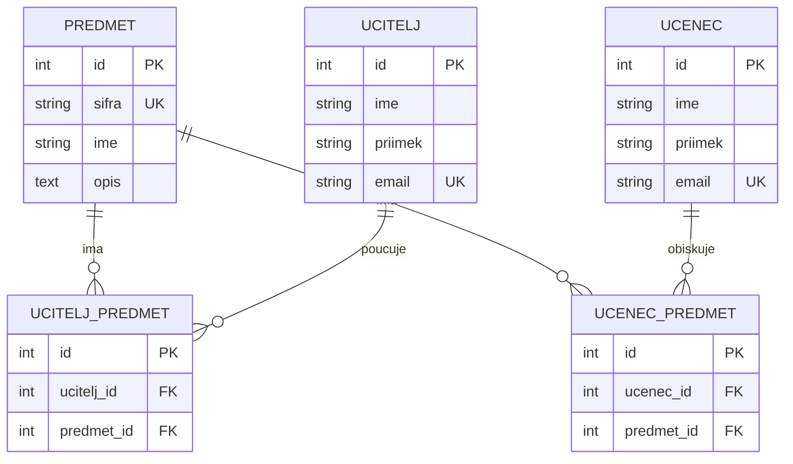
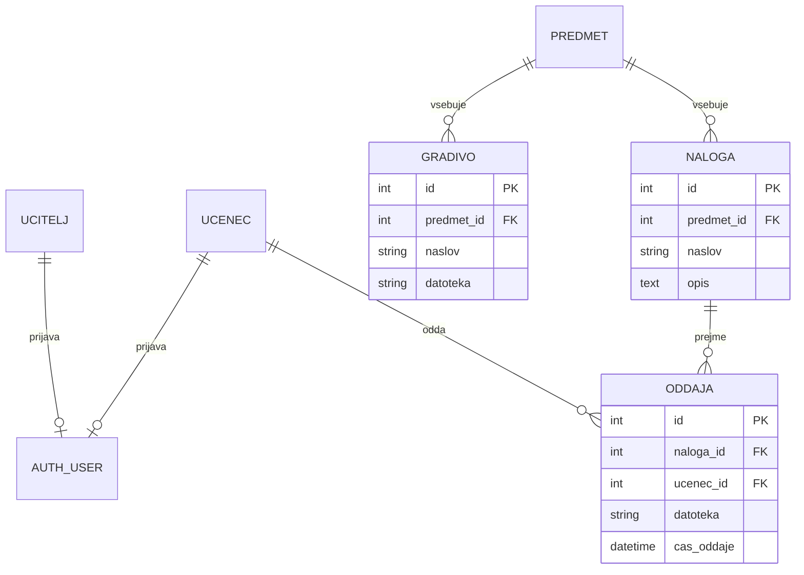

# ER diagram podatkovne baze

## Trenutna shema (implementirana do 3. tedna)

`UCITELJ_PREDMET` in `UCENEC_PREDMET` sta eksplicitni presečni (M:N) tabeli z
unikatno omejitvijo na paru tujih ključev (`(ucitelj_id, predmet_id)` in
`(ucenec_id, predmet_id)`), kar preprečuje podvojene povezave. Skupaj je to
**5 tabel**, kar presega zahtevanih najmanj 4.

## Načrtovana razširitev (4. teden – prijava, gradiva, naloge)

`AUTH_USER` je Djangov vgrajeni model uporabnikov (`django.contrib.auth.User`);
`UCITELJ`/`UCENEC` bosta v 4. tednu dobila neobvezen `OneToOne` na ta model za
prijavo in avtorizacijo (dve vrsti uporabnikov: učitelj, učenec — administrator
je Djangov `is_staff`/`is_superuser`).
