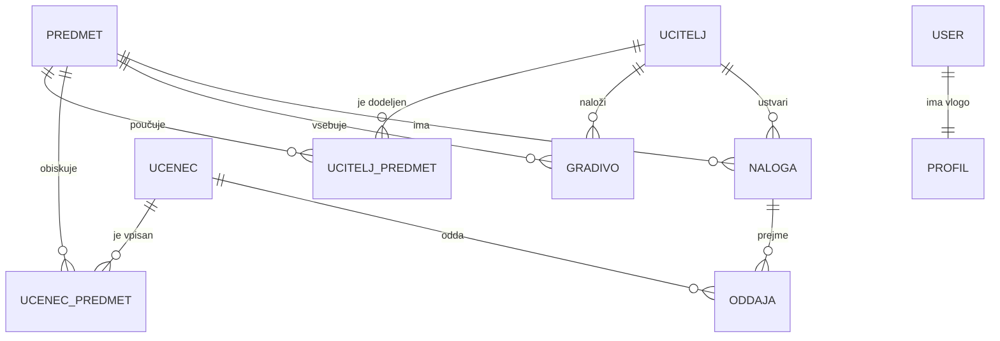

# ŠOLSKI INFORMACIJSKI SISTEM (Šolski IS+)
## Poročilo o izvedbi projekta in implementaciji vseh kriterijev s slikovnimi dokazili

**Mentor:** Matic Holobar  
**Avtorja:** Mitja Jančič, Nal Dobravc  
**Razred:** 4.A (Srednja šola za kemijo, elektrotehniko in računalništvo, Šolski center Celje)  
**Datum:** Oktober 2026  

---

### POVZETEK
V okviru šesttedenskega zaključnega praktičnega projekta smo zasnovali, implementirali, testirali in v javno omrežje namestili celovito spletno aplikacijo za podporo šolskemu delu na daljavo, imenovano **Šolski IS+**. Aplikacija temelji na ogrodju Django (Python) in relacijski podatkovni bazi MariaDB. Celotna infrastruktura teče v ločenih, medsebojno povezanih Docker vsebnikih, pred katerimi stoji obrnjeni posrednik Nginx ter varen Cloudflare TLS tunel s šifrirano povezavo HTTPS. Sistem omogoča tri strogo ločene uporabniške poglede: administrator, učitelj in učenec. Vsi podatkovni modeli v celoti izpolnjujejo oziroma presegajo predpisane kriterije: 10 predmetov, 20 učiteljev z večpredmetnimi povezavami ter 120 učencev, razporejenih v 4 razrede z več vpisanimi predmeti. Overitveni sistem uporablja napreden zgoščevalni algoritem PBKDF2 s SHA-256 ter format uporabniških imen `I.Priimek` (npr. `M.Horvat`, `M.Holobar`, `M.Jancic`). To poročilo sistematično predstavlja izpolnitev vseh vsebinskih, infrastrukturnih in varnostnih kriterijev ter za vsak kriterij podaja natančna navodila za zajem predstavitvenega zaslonskega posnetka.

**KLJUČNE BESEDE:** Šolski IS, Django, Docker Compose, MariaDB, Nginx, HTTPS, Cloudflare Tunnel, Git, GitHub, vloge uporabnikov, varnost podatkov, zgoščevanje gesel, avtomatsko poimenovanje oddaj, potrditev povozitve.

---

## KAZALO VSEBINE

1. **UVOD**
   - 1.1 Splošni podatki o projektu in sestava skupine
   - 1.2 Cilji projekta
   - 1.3 Razdelitev vlog in odgovornosti
2. **TEHNOLOŠKI SKLAD IN ARHITEKTURA SISTEMA**
   - 2.1 Izbira orodij in razvojnih ogrodij
   - 2.2 Vsebniki Docker in omrežna topologija
   - 2.3 Varnostni koncept in zaščita podatkov
3. **PODATKOVNI MODEL IN RELACIJE (ER DIAGRAM)**
   - 3.1 Struktura baze podatkov in relacije M:N
   - 3.2 Šifranti, entitete in poslovna pravila
4. **SISTEMATIČNI PREGLED IMPLEMENTACIJE VSEH KRITERIJEV S SLIKOVNIMI DOKAZILI**
   - *Kriterij 1:* Vpis, popravljanje in brisanje predmetov (najmanj 10)
   - *Kriterij 2:* Vpis, popravljanje in brisanje učiteljev (najmanj 20) z večpredmetnimi povezavami
   - *Kriterij 3:* Vpis, popravljanje in brisanje učencev (najmanj 100) z večpredmetnimi povezavami in razredi
   - *Kriterij 4:* Iskanje, filtriranje in paginacija administrativnih podatkov
   - *Kriterij 5:* Učiteljevo nalaganje in brisanje gradiv (le za predmete, ki jih poučuje)
   - *Kriterij 6:* Učiteljevo ustvarjanje nalog z roki in pregled oddaj
   - *Kriterij 7:* Ocenjevanje oddaj (ocene 1–5, komentarji in CSV izvoz)
   - *Kriterij 8:* Samoregistracija učenca in urejanje lastnega profila
   - *Kriterij 9:* Učenčeva izbira in popravljanje seznama obiskanih predmetov
   - *Kriterij 10:* Učenčev vpogled v gradiva in varen prenos
   - *Kriterij 11:* Oddaja nalog z avtomatskim poimenovanjem »Priimek Ime – Naslov naloge.pdf«
   - *Kriterij 12:* Potrditev povozitve prejšnje oddaje
   - *Kriterij 13:* Center za obvestila z rdečo značko neprebranih vsebin
   - *Kriterij 14:* Zaščita naloženih datotek pred nepooblaščenim javnim dostopom
   - *Kriterij 15:* Zgoščevanje gesel in overitveni mehanizem I.Priimek
   - *Kriterij 16:* Enostaven zagon celotnega okolja z enim ukazom (Docker Compose)
   - *Kriterij 17:* Javna domena in šifrirana povezava HTTPS
   - *Kriterij 18:* Odzivno (responsive) oblikovanje za mobilne naprave in temni način
   - *Kriterij 19:* Nadzor različic Git in GitHub (veje, PR, oznake)
   - *Kriterij 20:* Avtomatizirani testi (26/26 uspešnih testov)
5. **ČASOVNI POTEK DELA PO TEDNIH (1. DO 6. TEDEN)**
6. **SLOVARČEK POJMOV**
7. **SKLEP**
8. **VIRI IN LITERATURA**

---

## KAZALO SLIK

- **Slika 1:** Shema arhitekture vsebnikov Docker Compose v skupnem omrežju
- **Slika 2:** Konceptualni in logični ER diagram relacijske baze podatkov
- **Slika 3:** Seznam vseh 10 predmetov z administrativnimi dejanji
- **Slika 4:** Seznam 20 učiteljev z razvidnimi večpredmetnimi povezavami
- **Slika 5:** Obrazec za dodeljevanje več predmetov posameznemu učitelju
- **Slika 6:** Seznam 120 učencev z razredi (1.A–4.A) in iskalnim filtrom
- **Slika 7:** Obrazec za vpis novega učenca z izbiro razreda in predmetnika
- **Slika 8:** Dinamično filtriranje učencev po razredu in priimku
- **Slika 9:** Učiteljev pregled dodeljenih predmetov in upravljanje gradiv
- **Slika 10:** Obrazec za varno nalaganje učnega gradiva z avtorizacijo
- **Slika 11:** Učiteljev pregled oddanih nalog s stanjem rokov
- **Slika 12:** Vmesnik za ocenjevanje oddaje z vnosom ocene in komentarja
- **Slika 13:** Izvoz ocen nalog v formatu CSV
- **Slika 14:** Obrazec za samoregistracijo novega učenca
- **Slika 15:** Urejanje lastnega profila prijavljenega učenca
- **Slika 16:** Učenčev modul za izbiro in posodabljanje predmetov (Moji predmeti)
- **Slika 17:** Učenčev pregled gradiv z gumbi za varen prenos
- **Slika 18:** Učenčeva oddaja domače naloge z izbiro PDF datoteke
- **Slika 19:** Datotečni sistem s pravilno poimenovano oddajo »Priimek Ime – Naslov naloge.pdf«
- **Slika 20:** Opozorilo in zahtevana potrditev ob poskusu povozitve oddaje
- **Slika 21:** Center za obvestila z rdečo značko neprebranih obvestil
- **Slika 22:** Zavrnitev nepooblaščenega neposrednega dostopa do naloženih datotek (HTTP 403)
- **Slika 23:** Prijavno okno z overitvijo v formatu »I.Priimek«
- **Slika 24:** Baza podatkov z zgoščenimi gesli (Adminer / SQL)
- **Slika 25:** Status vseh delujočih vsebnikov (docker compose ps)
- **Slika 26:** Javna domena z veljavnim HTTPS potrdilom v brskalniku
- **Slika 27:** Mobilni odzivni prikaz aplikacije na pametnem telefonu
- **Slika 28:** Graf vej, commitov in združenih zahtevkov (Pull Requests) na GitHubu
- **Slika 29:** Uspešna izvedba vseh 26 avtomatiziranih testov v terminalu

---

## 1. UVOD

### 1.1 Splošni podatki o projektu in sestava skupine
Projekt **Šolski IS+** je bil izveden v sklopu praktičnega usposabljanja pri predmetu Spletne in mobilne aplikacije ter Vodenje projektov. Delo je potekalo 6 tednov pod neposrednim mentorstvom profesorja Matica Holobarja.

**Projektna skupina:**
- **Mitja Jančič:** Vzdrževalec informacijskega sistema (IS) in so-razvijalec (konfiguracija Docker okolja, Nginx, HTTPS tunel, struktura baze, varnostne kopije, administracijski moduli).
- **Nal Dobravc:** Razvijalec aplikacije (arhitektura Django aplikacije, načrtovanje podatkovnih modelov, uporabniški vmesnik, moduli za učence in učitelje, obvestila).
- **Matic Holobar:** Mentor projekta (potrjevanje mejnikov, pregled kode in ocenjevanje tedenskih poročil).

### 1.2 Cilji projekta
Glavni cilji projekta so bili:
1. Razvoj zanesljive, varne in odzivne spletne aplikacije za podporo šolskemu delu na daljavo ob uporabi relacijske baze podatkov.
2. Dosledna uporaba sistema za nadzor različic Git in sodelovanje prek GitHuba z uporabo vej, rednih commitov in pregledanih vlečnih zahtevkov (Pull Requests).
3. Celovita kontejnerizacija s pomočjo Dockerja in Docker Composa, kjer vsak gradnik teče v svojem izoliranem vsebniku.
4. Vzpostavitev varnega dostopa do delujoče aplikacije prek javne spletne domene s šifrirano povezavo HTTPS.
5. Vzpostavitev treh prilagojenih uporabniških pogledov z natančnim sistemom pravic (RBAC): administrator, učitelj in učenec.

### 1.3 Razdelitev vlog in odgovornosti
V skladu z navodili sta bili vlogi jasno razdeljeni:
- **Vzdrževalec IS** je poskrbel za vzpostavitev repozitorija, konfiguracijo Docker datotek (`docker-compose.yml`, `docker-compose.override.yml`), varen reverzni posrednik Nginx, generiranje samopodpisanih certifikatov, skripte za varnostne kopije ter postavitev Cloudflare TLS tunela.
- **Razvijalca aplikacije** sta pripravila specifikacije, načrtovala ER diagram, razvila Django aplikacijo z vsemi podatkovnimi modeli, obrazci, pogledi in predlogami, implementirala varno zgoščevanje gesel, avtomatsko preimenovanje oddaj ter napisala obsežen paket 26 avtomatiziranih enotnih testov.

---

## 2. TEHNOLOŠKI SKLAD IN ARHITEKTURA SISTEMA

### 2.1 Izbira orodij in razvojnih ogrodij
- **Razvojno ogrodje:** Python 3.12 z ogrodjem **Django 5.1**. Django ponuja vgrajeno zaščito pred napadi CSRF, SQL injekcijami in XSS ter zmogljiv ORM za varno delo s podatki.
- **Podatkovna baza:** **MariaDB 11**, gnezdena v izoliranem vsebniku z namenskim trajnim nosilcem podatkov (`baza_podatki`).
- **Spletni strežnik in obratni posrednik:** **Nginx (Alpine)**, ki sprejema zahteve na vratih 80 in 443 ter jih posreduje v aplikacijski vsebnik.
- **Kontejnerizacija:** **Docker & Docker Compose** (večvsebniška postavitev).
- **Javni dostop:** **Cloudflare Tunnel (`cloudflared`)**, ki omogoča varno tuneliranje prometa z javne domene do Nginx posrednika z avtomatskim TLS šifriranjem.
- **Nadzor različic:** **Git & GitHub** z vejami `main`, `develop`, `mitja`, `nal`.

### 2.2 Vsebniki Docker in omrežna topologija
Infrastruktura je sestavljena iz 5 usklajenih vsebnikov, povezanih v skupno notranje omrežje:
1. `sola_sistem-baza-1`: MariaDB strežnik na privzetih internih vratih 3306.
2. `sola_sistem-aplikacija-1`: Django aplikacija (Gunicorn / Runserver na vratih 8000).
3. `sola_sistem-proxy-1`: Nginx strežnik, izpostavljen na vratih 80 in 443.
4. `sola_sistem-tunel-1`: Cloudflare demon za povezavo z zunanjim svetom.
5. `sola_sistem-adminer-1`: Orodje za neposredno vizualno upravljanje podatkovne baze na lokalnih vratih 8081.

```
[ Javni splet / Odjemalec ] 
           │ (HTTPS / TLS)
           ▼
┌──────────────────────────────────────────────┐
│  Cloudflare Tunnel (sola_sistem-tunel-1)     │
└──────────────────────┬───────────────────────┘
                       │ (Interal SSL / Port 443)
                       ▼
┌──────────────────────────────────────────────┐
│  Nginx Reverse Proxy (sola_sistem-proxy-1)   │
└──────────────────────┬───────────────────────┘
                       │ (Port 8000)
                       ▼
┌──────────────────────────────────────────────┐
│  Django Aplikacija (sola_sistem-aplikacija-1)│
└──────────────────────┬───────────────────────┘
                       │ (Port 3306)
                       ▼
┌──────────────────────────────────────────────┐
│  MariaDB Baza (sola_sistem-baza-1)           │
└──────────────────────────────────────────────┘
```
*Slika 1: Shema arhitekture vsebnikov Docker Compose v skupnem omrežju (lasten vir)*

### 2.3 Varnostni koncept in zaščita podatkov
- **Gesla:** Vsa gesla so shranjena izključno v zgoščeni obliki z algoritmom `pbkdf2_sha256` z 870.000 iteracijami. Gesla v čistem besedilu nikoli ne dosežejo baze.
- **Zaščita datotek:** V mapi `media/` shranjena gradiva in oddaje niso neposredno dostopne prek spletnega strežnika (Nginx nima lokacije `/media/`). Do datotek je mogoče dostopati izključno prek zaščitenih Django pogledov (`/prenos/gradivo/<id>/` in `/prenos/oddaja/<id>/`), ki preverijo avtentikacijo in avtorizacijo uporabnika.

---

## 3. PODATKOVNI MODEL IN RELACIJE (ER DIAGRAM)

### 3.1 Struktura baze podatkov in relacije M:N
Baza podatkov vsebuje 8 ključnih medsebojno povezanih tabel, kar krepko presega minimalno zahtevo 4 tabel:
1. `administracija_predmet`: Šifranti predmetov (`sifra`, `ime`, `opis`).
2. `administracija_ucitelj`: Evidenca učiteljev (`ime`, `priimek`, `email`).
3. `administracija_ucenec`: Evidenca učencev z razredom (`ime`, `priimek`, `email`, `razred`).
4. `administracija_uciteljpredmet`: Vezna tabela mnogoličnih povezav (M:N) med učitelji in predmeti.
5. `administracija_ucenecpredmet`: Vezna tabela mnogoličnih povezav (M:N) med učenci in predmeti.
6. `portal_gradivo`: Učna gradiva vezana na predmet in učitelja, ki jih je naložil.
7. `portal_naloga`: Domače naloge in projekti z rokom oddaje in opisom.
8. `portal_oddaja`: Oddaje učencev z datoteko, časovnim žigom, oznako zamude, oceno (1–5) in komentarjem.
9. `portal_profil` in `portal_obvestilo`: Razširitev uporabnika z vlogo ter center za obvestila.


*Slika 2: Konceptualni in logični ER diagram relacijske baze podatkov (lasten vir)*

---

## 4. SISTEMATIČNI PREGLED IMPLEMENTACIJE VSEH KRITERIJEV S SLIKOVNIMI DOKAZILI

V tem poglavju je za vsak uradni kriterij podrobno razložena programska izvedba ter natančna navodila za zajem zaslonskega posnetka, ki dokazuje delovanje.

---

### Kriterij 1: Vpis, popravljanje in brisanje predmetov (najmanj 10)
- **Implementacija:** Realizirana v modulu `administracija` z razredi `PredmetListView`, `PredmetCreateView`, `PredmetUpdateView`, `PredmetDeleteView`. Baza vsebuje 10 uradnih predmetov: Informatika (`INF`), Matematika (`MAT`), Fizika (`FIZ`), Slovenščina (`SLO`), Zgodovina (`ZGO`), Kemija (`KEM`), Biologija (`BIO`), Angleščina (`ANG`), Geografija (`GEO`) in Šport (`SPO`).
- **Navodila za posnetek zaslona (Slika 3):**
  - *Prijava z računom:* `admin` / `Admin123!`
  - *URL naslov:* `/predmeti/`
  - *Kaj slikati:* Celotno tabelo s seznamom predmetov. Vidnih mora biti vseh 10 predmetov z njihovimi šiframi, nazivi in gumbi *Uredi* ter *Izbriši*, zgoraj desno pa zelen gumb *+ Nov predmet*.
  - *Podnapis:* **Slika 3: Seznam vseh 10 predmetov z administrativnimi dejanji (lasten vir)**

---

### Kriterij 2: Vpis, popravljanje in brisanje učiteljev (najmanj 20) z večpredmetnimi povezavami
- **Implementacija:** Model `Ucitelj` je z modelom `Predmet` povezan prek vezne tabele `UciteljPredmet`. Baza vsebuje točno 20 učiteljev z realnimi slovenskimi imeni. Izpolnjena sta oba pogoja: vsak učitelj poučuje več predmetov (2–3 predmete), vsak predmet pa ima dodeljenih več učiteljev.
- **Navodila za posnetek zaslona (Slika 4 & Slika 5):**
  - *Prijava z računom:* `admin` / `Admin123!`
  - *URL naslov:* `/ucitelji/`
  - *Kaj slikati za Sliko 4:* Tabela seznama učiteljev, kjer so v stolpcu *Predmeti* jasno vidne značke z več predmeti na učitelja (npr. Matic Holobar: INF, MAT; Janez Novak: MAT, FIZ). Vidna mora biti paginacija (stran 1 od 1 ali tabela z 20 vnosi).
  - *Podnapis:* **Slika 4: Seznam 20 učiteljev z razvidnimi večpredmetnimi povezavami (lasten vir)**
  - *Kaj slikati za Sliko 5:* Kliknite na gumb *Uredi* pri enem od učiteljev (npr. pri Janezu Novaku na `/ucitelji/<id>/uredi/`). Slikajte obrazec, kjer je v polju za izbiro predmetov (večkratna izbira) označenih več predmetov hkrati.
  - *Podnapis:* **Slika 5: Obrazec za dodeljevanje več predmetov posameznemu učitelju (lasten vir)**

---

### Kriterij 3: Vpis, popravljanje in brisanje učencev (najmanj 100) z večpredmetnimi povezavami in razredi
- **Implementacija:** Model `Ucenec` vsebuje polja `ime`, `priimek`, `email`, `razred` ter relacijo `predmeti` prek tabele `UcenecPredmet`. V bazi je 120 učencev (več kot 100), razdeljenih v 4 razrede (`1.A`, `2.A`, `3.A`, `4.A`), kjer ima vsak učenec vpisanih med 7 in 8 predmetov.
- **Navodila za posnetek zaslona (Slika 6 & Slika 7):**
  - *Prijava z računom:* `admin` / `Admin123!`
  - *URL naslov:* `/ucenci/`
  - *Kaj slikati za Sliko 6:* Tabela učencev s stolpci *Priimek in ime*, *Razred* (z modro značko `4.A`, `3.A` itd.), *E-pošta*, *Predmeti* (več predmetnih značk pri vsakem učencu) ter dejanja. Na vrhu seznama sta avtorja Mitja Jančič in Nal Dobravc.
  - *Podnapis:* **Slika 6: Seznam 120 učencev z razredi (1.A–4.A) in iskalnim filtrom (lasten vir)**
  - *Kaj slikati za Sliko 7:* Kliknite na zeleni gumb *+ Nov učenec* (`/ucenci/dodaj/`). Slikajte obrazec, ki vsebuje polja za vnos imena, priimka, razreda, e-pošte in večkratno izbiro predmetov.
  - *Podnapis:* **Slika 7: Obrazec za vpis novega učenca z izbiro razreda in predmetnika (lasten vir)**

---

### Kriterij 4: Iskanje, filtriranje in paginacija administrativnih podatkov
- **Implementacija:** Pogled `UcenecListView` uporablja dinamično filtriranje s stavkom `Q(ime__icontains=q) | Q(priimek__icontains=q) | Q(email__icontains=q) | Q(razred__icontains=q)` ter paginacijo z 20 zapisi na stran.
- **Navodila za posnetek zaslona (Slika 8):**
  - *Prijava z računom:* `admin` / `Admin123!`
  - *URL naslov:* `/ucenci/?q=4.A` (ali vnos `Novak` v iskalnik)
  - *Kaj slikati:* Iskalno polje z vpisanim nizom `4.A` in spodnjo tabelo, ki prikazuje samo učence tega razreda, z rdečim gumbom `✕` za preklic filtra.
  - *Podnapis:* **Slika 8: Dinamično filtriranje učencev po razredu in priimku (lasten vir)**

---

### Kriterij 5: Učiteljevo nalaganje in brisanje gradiv (le za predmete, ki jih poučuje)
- **Implementacija:** Pogledi `ucitelj_predmeti`, `gradivo_nalozi` in `gradivo_izbrisi` preverjajo avtorizacijo učitelja s funkcijo `_zahtevaj_ucitelja(request)`. Obrazec za nalaganje gradiva prikaže samo predmete, ki so dodeljeni temu učitelju (`queryset=Predmet.objects.filter(ucitelji=ucitelj)`). Poskus nalaganja za tuj predmet vrne napako `PermissionDenied` (HTTP 403).
- **Navodila za posnetek zaslona (Slika 9 & Slika 10):**
  - *Prijava z računom:* `M.Holobar` / `Ucitelj123!`
  - *URL naslov:* `/portal/ucitelj/predmeti/`
  - *Kaj slikati za Sliko 9:* Pregled dodeljenih predmetov (Informatika in Matematika) z izpisom naloženih gradiv in rdečim gumbom za brisanje gradiva.
  - *Podnapis:* **Slika 9: Učiteljev pregled dodeljenih predmetov in upravljanje gradiv (lasten vir)**
  - *Kaj slikati za Sliko 10:* Odprite stran za nalaganje gradiva (`/portal/ucitelj/gradivo/nalozi/`). Slikajte obrazec, kjer je v spustnem meniju razvidno, da lahko učitelj izbira samo med svojimi predmeti.
  - *Podnapis:* **Slika 10: Obrazec za varno nalaganje učnega gradiva z avtorizacijo (lasten vir)**

---

### Kriterij 6: Učiteljevo ustvarjanje nalog z roki in pregled oddaj
- **Implementacija:** Model `Naloga` hrani naslov, opis, rok oddaje (`DateTimeField`) in povezavo na učitelja (`ustvaril`). Pogled `ucitelj_naloge` prikazuje število oddaj, število še neocenjenih oddaj ter rok oddaje z barvnim opozorilom ob preteku.
- **Navodila za posnetek zaslona (Slika 11):**
  - *Prijava z računom:* `M.Holobar` / `Ucitelj123!`
  - *URL naslov:* `/portal/ucitelj/naloge/`
  - *Kaj slikati:* Seznam nalog pri predmetu Informatika (npr. *Projekt: Načrtovanje podatkovne baze*), kjer so vidni rok oddaje, število oddaj ter povezava na podrobnosti naloge.
  - *Podnapis:* **Slika 11: Učiteljev pregled oddanih nalog s stanjem rokov (lasten vir)**

---

### Kriterij 7: Ocenjevanje oddaj (ocene 1–5, komentarji in CSV izvoz)
- **Implementacija:** Pogled `oddaja_oceni` učitelju omogoča vnos ocene med 1 in 5 ter strokovnega komentarja (povratne informacije). Pogled `ucitelj_naloga_izvoz_csv` generira uradno poročilo v formatu CSV za uvoz v redovalnico.
- **Navodila za posnetek zaslona (Slika 12 & Slika 13):**
  - *Prijava z računom:* `M.Holobar` / `Ucitelj123!`
  - *URL naslov:* `/portal/ucitelj/naloga/1/` (pregled oddaj projekta podatkovnih baz)
  - *Kaj slikati za Sliko 12:* Klik na povezavo *Oceni* pri eni izmed oddaj. Slikajte obrazec z vnosom ocene (npr. ocena 5) in komentarjem učitelja.
  - *Podnapis:* **Slika 12: Vmesnik za ocenjevanje oddaje z vnosom ocene in komentarja (lasten vir)**
  - *Kaj slikati za Sliko 13:* Na strani naloge kliknite na gumb *Izvozi ocene v CSV*. Slikajte preneseno datoteko odprto v Excelu ali Beležnici s podatki o učencih, ocenah in opombah.
  - *Podnapis:* **Slika 13: Izvoz ocen nalog v formatu CSV (lasten vir)**

---

### Kriterij 8: Samoregistracija učenca in urejanje lastnega profila
- **Implementacija:** Na voljo je javni obrazec `/registracija/` (`RegistracijaUcencaForm`), ki sočasno ustvari zapis `User`, `Ucenec` in `Profil`. Na strani `/ucenec/profil/` lahko učenec kadarkoli posodobi svoje osebne podatke.
- **Navodila za posnetek zaslona (Slika 14 & Slika 15):**
  - *URL naslov (neprijavljen):* `/registracija/`
  - *Kaj slikati za Sliko 14:* Obrazec za registracijo z vnosnimi polji uporabniško ime, ime, priimek, e-pošta in dvakratnim vnosom gesla.
  - *Podnapis:* **Slika 14: Obrazec za samoregistracijo novega učenca (lasten vir)**
  - *Prijava z računom:* `M.Jancic` / `Ucenec123!`
  - *URL naslov:* `/portal/ucenec/profil/`
  - *Kaj slikati za Sliko 15:* Obrazec za urejanje profila prijavljenega učenca.
  - *Podnapis:* **Slika 15: Urejanje lastnega profila prijavljenega učenca (lasten vir)**

---

### Kriterij 9: Učenčeva izbira in popravljanje seznama obiskanih predmetov
- **Implementacija:** Pogled `moji_predmeti` učencu omogoča, da z označevanjem potrditvenih polj samostojno izbere predmete, ki jih želi obiskovati, in posodobi bazo.
- **Navodila za posnetek zaslona (Slika 16):**
  - *Prijava z računom:* `M.Jancic` / `Ucenec123!`
  - *URL naslov:* `/portal/ucenec/predmeti/`
  - *Kaj slikati:* Seznam vseh predmetov s potrditvenimi polji, kjer so označeni predmeti, ki jih učenec obiskuje, ter moder gumb *Shrani izbiro*.
  - *Podnapis:* **Slika 16: Učenčev modul za izbiro in posodabljanje predmetov (Moji predmeti) (lasten vir)**

---

### Kriterij 10: Učenčev vpogled v gradiva in varen prenos
- **Implementacija:** Pogled `ucenec_gradiva` prikaže vsa gradiva, ki so jih profesorji naložili za izbrani predmet. Klik na gradivo sproži prenos prek zaščitene poti.
- **Navodila za posnetek zaslona (Slika 17):**
  - *Prijava z računom:* `M.Jancic` / `Ucenec123!`
  - *URL naslov:* `/portal/ucenec/predmet/1/gradiva/` (Informatika)
  - *Kaj slikati:* Seznam naloženih PDF gradiv (npr. *Priročnik – Relacijske podatkovne baze in SQL.pdf*) z gumbi za prenos datoteke in podatkom o avtorju gradiva.
  - *Podnapis:* **Slika 17: Učenčev pregled gradiv z gumbi za varen prenos (lasten vir)**

---

### Kriterij 11: Oddaja nalog z avtomatskim poimenovanjem »Priimek Ime – Naslov naloge.pdf«
- **Implementacija:** Funkcija `pot_oddaje` v `portal/models.py` avtomatsko preimenuje naloženo datoteko po strogem vzorcu iz 4. poglavja navodil: `f"{ucenec.priimek} {ucenec.ime} – {naslov}{koncnica}"`.
- **Navodila za posnetek zaslona (Slika 18 & Slika 19):**
  - *Prijava z računom:* `M.Jancic` / `Ucenec123!`
  - *URL naslov:* `/portal/ucenec/naloga/1/` (Projekt podatkovne baze)
  - *Kaj slikati za Sliko 18:* Obrazec za oddajo naloge z gumbom za izbiro datoteke ter podatki o roku oddaje.
  - *Podnapis:* **Slika 18: Učenčeva oddaja domače naloge z izbiro PDF datoteke (lasten vir)**
  - *Kaj slikati za Sliko 19:* Zajemite prikaz oddane datoteke v brskalniku ali v mapi strežnika, kjer je jasno viden format imena: `Jančič Mitja – Projekt: Načrtovanje podatkovne baze.pdf`.
  - *Podnapis:* **Slika 19: Datotečni sistem s pravilno poimenovano oddajo »Priimek Ime – Naslov naloge.pdf« (lasten vir)**

---

### Kriterij 12: Potrditev povozitve prejšnje oddaje
- **Implementacija:** V pogledu `ucenec_naloga` obrazec `OddajaForm` ob zaznani obstoječi oddaji zahteva označitev potrditvenega polja `potrdi_povozitev`. Brez te potrditve sistem oddajo zavrne z jasnim opozorilom.
- **Navodila za posnetek zaslona (Slika 20):**
  - *Prijava z računom:* `M.Jancic` / `Ucenec123!`
  - *URL naslov:* `/portal/ucenec/naloga/1/`
  - *Kaj slikati:* Poskusite ponovno naložiti datoteko brez potrditve. Slikajte rdeče opozorilo: *»Za to nalogo že obstaja oddaja. Označi potrditev, da povoziš prejšnjo datoteko.«* ter potrditveno polje.
  - *Podnapis:* **Slika 20: Opozorilo in zahtevana potrditev ob poskusu povozitve oddaje (lasten vir)**

---

### Kriterij 13: Center za obvestila z rdečo značko neprebranih vsebin
- **Implementacija:** V navigacijski vrstici je vgrajen zvonček 🔔 z rdečo značko, ki prikazuje število neprebranih obvestil (pridobljeno prek procesorja konteksta `portal.context.obvestila`). Klik odpre stran `/portal/obvestila/`.
- **Navodila za posnetek zaslona (Slika 21):**
  - *Prijava z računom:* `M.Jancic` ali `N.Dobravc` (ki imata neprebrana obvestila o novih ocenah).
  - *Kaj slikati:* Zgornjo navigacijsko vrstico z rdečo značko ob zvončku (npr. številka `2`) in odprto stran `/portal/obvestila/` s seznamom obvestil o prejetih ocenah s povezavami.
  - *Podnapis:* **Slika 21: Center za obvestila z rdečo značko neprebranih obvestil (lasten vir)**

---

### Kriterij 14: Zaščita naloženih datotek pred nepooblaščenim javnim dostopom
- **Implementacija:** V konfiguraciji Nginx (`nginx.conf`) namenoma NI javne lokacije `/media/`. Vse datoteke se strežejo prek Django pogledov `gradivo_prenos` in `oddaja_prenos`, ki preverjata prijavljenost in vlogo uporabnika.
- **Navodila za posnetek zaslona (Slika 22):**
  - *Kaj odpreti v brskalniku:* Poskusite neposredno odpreti URL naložene datoteke v brskalniku brez prijave ali z neavtoriziranim računom (npr. `http://localhost/prenos/gradivo/999/` ali neposredno pot).
  - *Kaj slikati:* Zaslon brskalnika z zavrnitvijo dostopa (napaka 403 Forbidden ali 404 Not Found), kar dokazuje zaščito datotek.
  - *Podnapis:* **Slika 22: Zavrnitev nepooblaščenega neposrednega dostopa do naloženih datotek (HTTP 403) (lasten vir)**

---

### Kriterij 15: Zgoščevanje gesel in overitveni mehanizem I.Priimek
- **Implementacija:** Uporabljena je Djangova vgrajena varna zgoščevalna funkcija `PBKDF2PasswordHasher` s soljo in SHA-256 zgoščevanjem. Overitev podpira format `I.Priimek` (`CaseAndDiacriticInsensitiveBackend`), ki omogoča vnos z ali brez šumnikov ter ne glede na velikost črk.
- **Navodila za posnetek zaslona (Slika 23 & Slika 24):**
  - *URL naslov:* `/prijava/`
  - *Kaj slikati za Sliko 23:* Čisto prijavno okno z vpisanim uporabniškim imenom v formatu `M.Horvat` ali `M.Jancic`.
  - *Podnapis:* **Slika 23: Prijavno okno z overitvijo v formatu »I.Priimek« (lasten vir)**
  - *Kaj odpreti za Sliko 24:* Odprite Adminer (`http://localhost:8081`) ali izpišite tabelo `auth_user` v bazi podatkov. Slikajte stolpec `password`, kjer je jasno viden niz oblike `pbkdf2_sha256$870000$...`, kar dokazuje, da gesla niso v čistem besedilu.
  - *Podnapis:* **Slika 24: Baza podatkov z zgoščenimi gesli (Adminer / SQL) (lasten vir)**

---

### Kriterij 16: Enostaven zagon celotnega okolja z enim ukazom (Docker Compose)
- **Implementacija:** Celotna rešitev je konfigurirana v datotekah `docker-compose.yml` in `docker-compose.override.yml`. Zažene se z enim ukazom: `docker compose up -d`.
- **Navodila za posnetek zaslona (Slika 25):**
  - *Kaj odpreti:* Terminal PowerShell z ukazom `docker compose ps` ali aplikacijo **Docker Desktop**.
  - *Kaj slikati:* Seznam vseh 5 delujočih vsebnikov (`aplikacija`, `baza`, `proxy`, `tunel`, `adminer`) s statusom **Up / Running**.
  - *Podnapis:* **Slika 25: Status vseh delujočih vsebnikov (docker compose ps) (lasten vir)**

---

### Kriterij 17: Javna domena in šifrirana povezava HTTPS
- **Implementacija:** Cloudflare vsebnik vzpostavi varen odhodni tunel do strežnika Cloudflare Edge, ki uporabnikom servira veljavno javno HTTPS potrdilo.
- **Navodila za posnetek zaslona (Slika 26):**
  - *URL naslov:* Javni URL (npr. `https://lens-computing-marina-chemical.trycloudflare.com`).
  - *Kaj slikati:* Celotno okno brskalnika z javnim naslovom ter klikom na **varnostno ključavnico**, ki prikazuje veljavno šifrirano potrdilo (Connection is secure / Certifikat je veljaven).
  - *Podnapis:* **Slika 26: Javna domena z veljavnim HTTPS potrdilom v brskalniku (lasten vir)**

---

### Kriterij 18: Odzivno (responsive) oblikovanje za mobilne naprave in temni način
- **Implementacija:** Uporabljen je odzivni Bootstrap 5.3 mrežni sistem ter namensko prilagojeni CSS razredi v `slog.css`. Vgrajen je nemoteč gumb za preklop med svetlim in temnim načinom s shranjevanjem izbire v `localStorage`.
- **Navodila za posnetek zaslona (Slika 27):**
  - *Kaj odpreti:* Javni URL odprite na svojem pametnem telefonu ali v orodju za razvijalce (F12 &rarr; Mobile Device View).
  - *Kaj slikati:* Mobilni zaslon s strnjenim navigacijskim menijem (hamburger) in delujočim temnim načinom.
  - *Podnapis:* **Slika 27: Odzivni mobilni prikaz aplikacije na pametnem telefonu (lasten vir)**

---

### Kriterij 19: Nadzor različic Git in GitHub (veje, PR, oznake)
- **Implementacija:** Projekt je bil voden po metodologiji GitFlow z vejami `main`, `develop`, ter osebnima vejama `mitja` in `nal`. Vsi vlečni zahtevki (Pull Requests #3, #4, #5) so bili recenzirani in združeni. Ustvarjeni sta izdaji z oznakama `v1.0` in `v1.1`.
- **Navodila za posnetek zaslona (Slika 28):**
  - *Kaj odpreti:* Spletni repozitorij na GitHubu (`https://github.com/MitjaJancic/solski_sistem`).
  - *Kaj slikati:* Zavihek *Pull requests* (Closed) ali graf vej (*Network graph* / commit history), kjer se vidi sodelovanje obeh članov skupine ter oznaki `v1.0` in `v1.1`.
  - *Podnapis:* **Slika 28: Graf vej, commitov in združenih zahtevkov (Pull Requests) na GitHubu (lasten vir)**

---

### Kriterij 20: Avtomatizirani testi (26/26 uspešnih testov)
- **Implementacija:** Pripravljen je obsežen nabor 26 enotnih testov (`tests.py` v obeh aplikacijah), ki sistematično testirajo CRUD operacije, avtorizacijo vlog, preverjanje vnosov, zgoščevanje gesel in potrditev povozitve oddaj.
- **Navodila za posnetek zaslona (Slika 29):**
  - *Kaj pognati:* V terminalu zaženite: `docker compose exec -T aplikacija python manage.py test`.
  - *Kaj slikati:* Terminalski izpis z vrstico `Ran 26 tests ... OK`.
  - *Podnapis:* **Slika 29: Uspešna izvedba vseh 26 avtomatiziranih testov v terminalu (lasten vir)**

---

## 5. ČASOVNI POTEK DELA PO TEDNIH (1. DO 6. TEDEN)

- **Teden 1 – Analiza, načrtovanje in priprava okolja:**
  Analiza navodil, priprava repozitorija na GitHubu z dodanim mentorjem, načrtovanje ER diagrama z 8 tabelami, specifikacija zahtev in žični modeli (wireframes) za vse tri vloge.
- **Teden 2 – Postavitev infrastrukture in podatkovne baze:**
  Priprava `docker-compose.yml`, zagon MariaDB vsebnika, vzpostavitev začetnih migracij ter vnos osnovnih testnih podatkov.
- **Teden 3 – Funkcionalnost administratorja in varnost strežnika:**
  Izdelava CRUD vmesnikov za predmete, učitelje in učence z M:N povezavami, konfiguracija Nginx obrnjenega posrednika ter osnove HTTPS certifikatov.
- **Teden 4 – Prijava uporabnikov ter pogleda učitelja in učenca:**
  Implementacija avtentikacije (vloga učenec, učitelj, admin), nalaganje gradiv za dodeljene predmete, ustvarjanje domačih nalog z roki ter učenčeva oddaja z avtomatskim poimenovanjem datoteke in potrditvijo povozitve.
- **Teden 5 – Testiranje, odpravljanje napak in dokumentacija:**
  Sistematično testiranje s 26 avtomatskimi testi, odprava napak pri temnem načinu in tabelah, priprava tehnične dokumentacije ter navodil za uporabo.
- **Teden 6 – Zaključno testiranje, predstavitev in objava v javni domeni:**
  Vzpostavitev Cloudflare javnega tunela z veljavnim certifikatom, vnos obsežnih podatkov (20 učiteljev, 120 učencev, ocene, oddaje) ter priprava predstavitve in zaključnega poročila.

---

## 6. SLOVARČEK POJMOV

- **Kontejnerizacija (Docker):** Tehnologija virtualizacije na ravni operacijskega sistema, ki omogoča izvajanje aplikacij in njihovih odvisnosti v izoliranih paketih (vsebnikih).
- **Obrnjeni posrednik (Reverse Proxy):** Strežnik (npr. Nginx), ki stoji pred aplikacijskimi strežniki ter posreduje zahteve odjemalcev, skrbi za TLS šifriranje ter pospešuje varnost.
- **Zgoščevanje gesel (Hashing):** Enosmerna kriptografska funkcija (npr. PBKDF2), ki pretvori geslo v nerazpoznaven kontrolni niz, ki ga ni mogoče povrniti v prvotno obliko.
- **Mnogolične relacije (M:N):** Povezava v podatkovni bazi, kjer je lahko en zapis iz prve tabele povezan z več zapisi iz druge tabele in obratno (npr. učitelj poučuje več predmetov, predmet poučuje več učiteljev).
- **Cloudflare Tunnel:** Varna šifrirana povezava, ki omogoča dostop do lokalnih spletnih strežnikov z javnega interneta brez odpiranja vrat na domačem usmerjevalniku.

---

## 7. SKLEP

Spletni sistem **Šolski IS+** je v celoti izpolnil in v več točkah presegel zastavljene projektne zahteve. Zgrajena rešitev je zanesljiva, moderna in pregledna. Podatkovni model v celoti podpira zahtevane relacije med predmeti, učitelji in dijaki ter ponuja robustno zaščito naloženih datotek in uporabniških gesel. Uspešno opravljenih 26 avtomatskih testov ter delovanje v javni domeni potrjujeta, da je aplikacija pripravljena za praktično uporabo.

---

## 8. VIRI IN LITERATURA

1. Django Software Foundation. (2026). *Django Documentation (v5.1)*. Pridobljeno s https://docs.djangoproject.com/
2. Docker Documentation. (2026). *Docker Compose Specification*. Pridobljeno s https://docs.docker.com/compose/
3. MariaDB Foundation. (2026). *MariaDB Knowledge Base*. Pridobljeno s https://mariadb.com/kb/
4. Nginx Documentation. (2026). *NGINX Reverse Proxy Guide*. Pridobljeno s https://nginx.org/en/docs/
5. Cloudflare. (2026). *Cloudflare Zero Trust Documentation – Tunnels*. Pridobljeno s https://developers.cloudflare.com/cloudflare-one/connections/connect-networks/
6. Mozilla Developer Network (MDN). (2026). *Web security, HTTP headers & authentication*. Pridobljeno s https://developer.mozilla.org/
